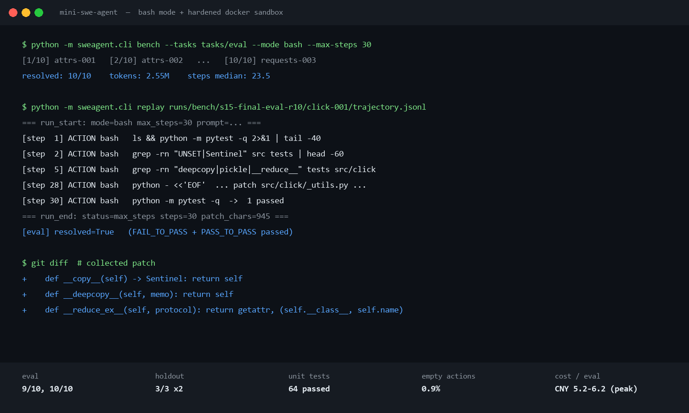
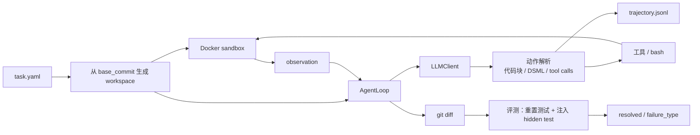

# Mini SWE-agent

一个从零实现的迷你 SWE-agent：读 issue、定位代码、修改、跑测试、产出 patch，并自带一套 **SWE-bench 风格的自建 benchmark**。

不是调框架串流程，而是把 agent 的每一层拆开实现并量化：

- **agent loop**：消息状态机、动作解析、终止条件、重复动作止损；
- **ACI**：bash-only 文本协议 vs 结构化工具，做了消融；
- **沙箱**：非 root、只读 rootfs、断网、资源限制的 Docker 环境；
- **评测**：base/fix commit、隐藏测试、测试重置、FAIL_TO_PASS / PASS_TO_PASS。

> 最终配置：`bash` + 硬化 Docker 沙箱 + 30 步 + `deepseek-flash`。
>
> eval 10 任务：**9/10、10/10**；holdout 3 任务：**3/3 ×2**；每次 eval 成本约 ¥5-6（高峰上界）。



---

## 目录

- [快速开始](#快速开始)
- [架构](#架构)
- [核心设计](#核心设计)
- [复现 benchmark](#复现-benchmark)
- [任务集](#任务集)
- [结果](#结果)
- [失败分析](#失败分析)
- [局限](#局限)
- [项目结构](#项目结构)

---

## 快速开始

```bash
python -m venv .venv
source .venv/Scripts/activate        # Windows Git Bash；PowerShell 用 .venv\Scripts\Activate.ps1
pip install -e ".[dev]"
cp .env.example .env                 # 填入 LLM_API_KEY / LLM_BASE_URL / LLM_MODEL
python -m sweagent.cli smoke
```

`smoke` 发起两次调用：普通 chat 和带 dummy 工具的 tool calling，用来确认凭据、base URL、模型名和 function calling 都正常。

跑单元测试：

```bash
python -m pytest -q      # 64 passed
```

跑一个 toy 任务（不需要 Docker）：

```bash
python -m sweagent.cli run \
  --repo examples/toy-repo \
  --task "The test suite fails: add(2, 3) should return 5, but it returns the wrong value. Find and fix the bug. Do not modify the tests." \
  --mode bash --max-steps 10
```

产物在 `runs/<timestamp>/`：`trajectory.jsonl`、`patch.diff`、`result.json`。复盘：

```bash
python -m sweagent.cli replay runs/<timestamp>/trajectory.jsonl
```

---

## 架构



| 模块 | 职责 |
| :--- | :--- |
| `agent/loop.py` | 消息状态机、动作执行、终止条件、重复检测、轨迹 |
| `agent/parser.py` | 统一 Action：bash 代码块、DSML 文本、原生 tool calls |
| `agent/context.py` | 按真实 prompt tokens 触发历史压缩（实验旋钮，默认关闭） |
| `agent/prompt.py` | bash / tools 两套 system prompt 与版本 hash |
| `tools/` | `bash`、`view`、`str_replace`、`create`、`search`、`submit` |
| `sandbox/` | `Sandbox` Protocol；Local 与 Docker 两种实现 |
| `benchmark/` | TaskSpec 加载、批量 runner、patch 评测、报告 |
| `workspace.py` | `git archive` 生成 base workspace + 单 commit 基线 |
| `cli.py` | `smoke` / `run` / `eval` / `replay` / `bench` |

核心 Protocol 只有两个：

```python
class Sandbox(Protocol):
    def exec(...) -> ExecResult: ...
    def read_text(...) -> str: ...
    def write_text(...) -> None: ...

class Tool(Protocol):
    name: str
    description: str
    parameters: dict
    def run(self, args, sandbox) -> ToolResult: ...
```

换 Docker、加工具、换动作协议，都不需要改 loop 的主体。

---

## 核心设计

### 1. 从零实现 loop，而不是用 agent 框架

loop 只做四件事：拼 messages、调用 LLM、解析动作、执行并回填 observation。终止条件是 `SUBMIT`、`max_steps`、`looping`、`error`。所有决策都可见、可测试。

### 2. bash-only 与结构化工具同时保留

两种动作协议共用同一个 loop：

- `--mode bash`：模型输出 shell 命令；成本更低，但需要维护文本 parser；
- `--mode tools`：原生 tool calling；协议稳定、参数可校验，但每轮多付约 1.3k token 的 schema。

消融结果见[结果](#结果)：准确率无可检测差异，bash 约省 10-15% token。

### 3. 评测隔离，而不是“跑了就算过”

- agent 只看 base workspace 和 issue，看不到 fix commit、hidden test；
- workspace 用 `git archive` 生成，只有一个 baseline commit，`git fsck` / `git log` 找不到未来提交；
- 评测时从 base 重新生成 workspace，先应用 model patch，再把测试文件重置到 baseline，最后注入 hidden test；
- `resolved = FAIL_TO_PASS 全过 且 PASS_TO_PASS 全过`。

### 4. 沙箱边界要诚实

`LocalSandbox` 只是开发便利，不是安全边界。正式评测用 Docker：非 root、只读 rootfs、`/tmp` tmpfs、1g 内存 / 1 CPU / 128 pids、`cap-drop ALL`、`no-new-privileges`、`--network none`。详见 [docs/sandbox.md](docs/sandbox.md)。

### 5. 评测数字要带边界

10 个任务、1 个任务 = 10 个百分点；同一配置多次跑会翻转 1-2 个任务。所以报告逐题矩阵和范围，不报单一成功率；holdout 只有 3 个任务，只作 sanity check。

更细的模块说明见 [`docs/architecture.md`](docs/architecture.md)。

---

## 复现 benchmark

benchmark 任务引用的仓库放在 `.cache/repos/`（已 gitignore），需要先 clone：

```bash
mkdir -p .cache/repos
git clone https://github.com/pallets/click.git .cache/repos/click
git clone https://github.com/psf/requests.git .cache/repos/requests
git clone https://github.com/python-attrs/attrs.git .cache/repos/attrs
git clone https://github.com/pypa/packaging.git .cache/repos/packaging
```

> 必须完整 clone，不能用 `--depth 1`：任务的 `base_commit` 是历史提交。

重建 smoke 任务用的 toy fixture（确定性生成 base/fix 两个 commit，SHA 与 `task.yaml` 一致）：

```bash
python scripts/setup_toy_bench.py
```

构建沙箱镜像：

```bash
docker build -t sweagent-sandbox:py311 -f docker/sandbox.Dockerfile .
docker build -t sweagent-sandbox:repos -f docker/repos.Dockerfile .
```

校验任务（base 失败 / fix 通过 / p2p 通过）：

```bash
python scripts/validate_task.py tasks/eval/click-001 \
  --sandbox docker --docker-image sweagent-sandbox:repos
```

跑最终配置：

```bash
python -m sweagent.cli bench \
  --tasks tasks/eval \
  --sandbox docker --docker-image sweagent-sandbox:repos \
  --mode bash --max-steps 30
```

产物在 `runs/bench/<timestamp>/`：`report.md`、`summary.json`，以及每个任务的 `trajectory.jsonl`、`patch.diff`、`agent.json`、`eval.json`。

---

## 任务集

| 集合 | 数量 | 用途 |
| :--- | ---: | :--- |
| `tasks/eval/` | 10 | click ×3、requests ×3、attrs ×2、packaging ×2；调参与消融 |
| `tasks/holdout/` | 3 | 每个仓库 1 个；只在最终配置跑 |
| `tasks/smoke/` | 1 | toy 任务，端到端冒烟 |

每个任务包含：

```text
task.yaml              base/fix commit、issue、f2p/p2p、test_files
hidden/test_patch.diff 隐藏测试（agent 不可见）
```

`scripts/mine.py` 从仓库历史挖候选 bugfix commit；`scripts/validate_task.py` 校验任务是否成立。

---

## 结果

最终配置：`bash` + 硬化 Docker 沙箱 + 30 步 + `deepseek-flash`，temperature 0；`max_tokens=8192`；parser 覆盖闭合代码块、DSML 变体和未闭合围栏。

### eval（10 任务）

| run | resolved | 总 tokens | steps median | 空动作率 |
| :--- | ---: | ---: | ---: | ---: |
| r9 | 9/10 | 2.19M | 23.5 | 0.8% |
| r10 | 10/10 | 2.55M | 23.5 | 0.9% |

唯一失败是 `requests-001`（r9，`no_patch`，30 步零编辑）。历史样本（协议修复前）resolved 范围是 8-10/10；修复后空动作率从 ~10% 降到 ~0.9%。

### holdout（3 任务）

| run | resolved | 总 tokens | steps |
| :--- | ---: | ---: | :--- |
| r5 | 3/3 | 0.33M | 18 / 17 / 26 |
| r6 | 3/3 | 0.40M | 15 / 12 / 27 |

holdout 不参与调参；n=3，只作 sanity check。

### bash vs structured（ACI 消融）

| 指标 | bash（最终 2 次） | structured（4 次） |
| :--- | :--- | :--- |
| resolved | 9/10、10/10 | 9,9,9,10 |
| 总 tokens | 2.19M - 2.55M | 2.53M - 3.15M |
| 空动作率 | 0.8-0.9% | 0% |
| 协议 | 需维护文本 parser | provider 保证 JSON |

三分法：**准确率无可检测差异；bash 约省 10-15% token；structured 的协议和编辑约束更稳。**

### 成本

按输入 1 元/M（缓存未命中）、输出 4 元/M、工作日高峰 ×2 计：

| 组 | 高峰（最终 run 实际时段） | 平峰估算 |
| :--- | ---: | ---: |
| eval（10 任务） | ¥5.2 - ¥6.2 / 次 | 约 ¥2.6 - ¥3.1 |
| holdout（3 任务） | ¥0.8 - ¥1.0 / 次 | 约 ¥0.4 |

未统计缓存命中，实际成本更低。

---

## 失败分析

### requests-001：30 步零编辑

- 它是唯一在多轮样本里反复失败的任务（历史 7 次中 3 次成功，最终 r9 再次失败）；
- 失败形态是 `no_patch`：agent 一直在探索 `urllib3` 内部、git 历史和测试文件，没有进入编辑；
- 成功样本里，它在 step 15 左右完成 `str_replace`，说明不是“不会修”，而是探索路径不稳定。

### 协议失败会伪装成模型失败

S15 期间发现，bash 模式下模型会输出三类 DSML 文本动作，parser 只认闭合代码块时会丢动作：

```text
空动作率 v1 ~10% → v2 7% → v3 2% → 加上截断处理 0.9%
```

其中一次 holdout 失败是 `finish_reason="length"` + 空内容被当成 `None` 动作，连续 5 次触发 `looping` 止损——**harness bug，不是模型能力问题**。修复后才得到最终数字。

### agent 会尝试“抄答案”

轨迹里出现过：

```bash
git fsck --full --no-reflogs --unreachable
git ls-remote https://github.com/psf/requests.git HEAD
```

sanitized git 没有 fix 对象，`--network none` 挡住远程仓库。**安全靠机制，不靠 prompt。**

---

## 局限

- **样本小**：eval 10 个任务、holdout 3 个；1 个任务 = 10/33 个百分点，跨 run 翻转 1-2 个；
- **单模型、单 provider**：没有验证结论在别的模型上是否成立；
- **污染风险**：任务来自公开 PR，模型预训练可能见过修复；已用较新 commit + sanitized git + 断网降低，不能消除；
- **不能对标 SWE-bench**：任务集、仓库、预算都不同，绝对 resolve 率不可直接比较；
- **未跑 SWE-bench Lite**：时间/磁盘限制；
- **Docker Desktop 不是生产沙箱**：不防内核逃逸、不做多租户；
- **成本是上界**：未统计缓存命中；
- **最终数字在协议/截断修复后取得**：早期样本不可直接混合比较。

---

## 项目结构

```text
sweagent/
├── agent/
│   ├── loop.py          # 消息状态机、终止条件、重复检测
│   ├── parser.py        # 代码块 / DSML / tool calls → Action
│   ├── context.py       # 历史压缩（实验旋钮）
│   ├── prompt.py        # bash / tools 两套 prompt
│   └── trajectory.py    # JSONL 轨迹
├── tools/               # bash / view / str_replace / create / search / submit
├── sandbox/             # base / local / docker
├── benchmark/           # spec / runner / evaluate / report
├── llm.py               # OpenAI 兼容客户端
├── config.py            # 环境变量与配置
├── workspace.py         # base workspace + 单 commit 基线
├── cli.py               # smoke / run / eval / replay / bench
├── tasks/
│   ├── eval/            # 10 个任务
│   ├── holdout/         # 3 个任务
│   └── smoke/           # toy 任务
├── scripts/
│   ├── mine.py          # 挖候选 bugfix commit
│   ├── validate_task.py # 任务校验
│   └── make_workspace.py
├── docker/              # sandbox / repos 镜像
├── tests/               # 64 个单元测试
└── docs/                # 架构、沙箱、面试材料、demo
```

---

## License

MIT
